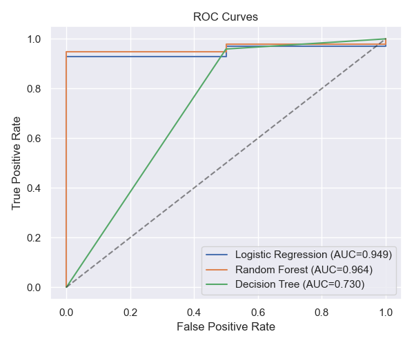
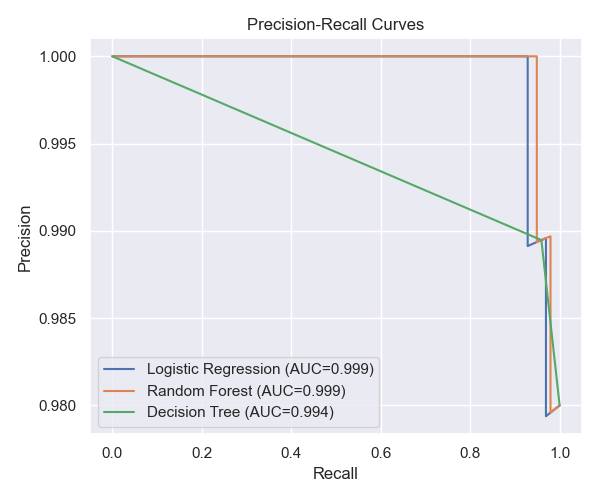
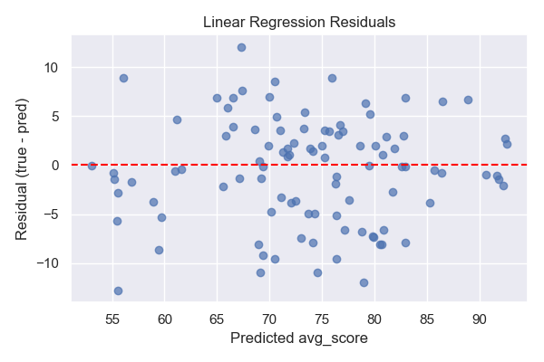
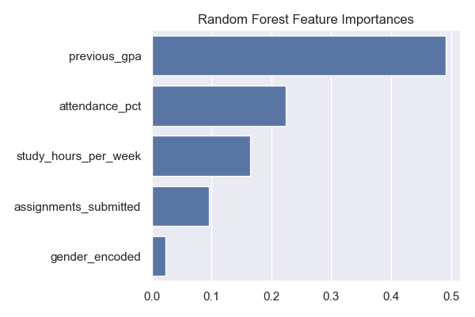

> **Possibly out of date:** this page was written for an earlier version of the project. For the current data, model selection and results see the [README](../README.md) and [09_model_selection.md](09_model_selection.md).


> **Note:** this document describes an earlier version of the project. The application now works on simulated UTAS-style transcripts (semesters, courses, marks, attendance, majors) and a semester planner; see the main [README](../README.md) for the current data, results and deployment steps. Figures and charts below are out of date.

## Machine Learning Models & Metrics

This document summarizes the machine learning models implemented in this project, the exact metrics the code computes, and guidance for comparing models.

**Project files referenced:**
- `app/ml/trainer.py` — contains training code and metric calculations.

**Targets**
- Regression target: final average score (continuous) — predicted by `LinearRegression`.
- Classification target: pass/fail (binary) — predicted by `LogisticRegression`, `RandomForestClassifier`, and `DecisionTreeClassifier`.

**Models implemented**

- Linear Regression
  - Purpose: predict continuous final average score.
  - Implementation: `sklearn.linear_model.LinearRegression()`
  - Metrics computed: RMSE (root mean squared error) and R² (coefficient of determination).

- Logistic Regression
  - Purpose: binary pass/fail classification.
  - Implementation: `sklearn.linear_model.LogisticRegression(max_iter=1000, random_state=42)`
  - Metrics computed: accuracy, precision, recall, F1, confusion matrix.

- Random Forest (Classifier)
  - Purpose: ensemble-based binary classification for pass/fail.
  - Implementation: `sklearn.ensemble.RandomForestClassifier(n_estimators=100, random_state=42)`
  - Metrics computed: accuracy, precision, recall, F1, confusion matrix.

- Decision Tree (Classifier)
  - Purpose: interpretable tree-based binary classification.
  - Implementation: `sklearn.tree.DecisionTreeClassifier(max_depth=6, random_state=42)`
  - Metrics computed: accuracy, precision, recall, F1, confusion matrix.

**Exact metric computation (as implemented)**
- Regression metrics (in `train_all_models`):
  - RMSE: computed as `float(np.sqrt(mean_squared_error(y_reg_test, y_pred)))`, rounded to 3 decimals.
  - R²: computed via `r2_score(y_reg_test, y_pred)`, rounded to 3 decimals.

- Classification metrics (via helper `_clf_metrics` in `trainer.py`):
  - Accuracy: `accuracy_score(y_true, y_pred)`, rounded to 3 decimals.
  - Precision: `precision_score(y_true, y_pred, zero_division=0)`, rounded to 3 decimals.
  - Recall: `recall_score(y_true, y_pred, zero_division=0)`, rounded to 3 decimals.
  - F1: `f1_score(y_true, y_pred, zero_division=0)`, rounded to 3 decimals.
  - Confusion matrix: `confusion_matrix(y_true, y_pred)` returned as a nested list.

**Result format returned by `train_all_models`**
- `train_all_models` returns a dictionary with entries for each model, e.g.:

```json
{
  "linear_regression": {
    "type": "regression",
    "name": "Linear Regression",
    "rmse": 4.123,
    "r2": 0.752,
    "description": "Predicts the final average score (continuous value)"
  },
  "logistic_regression": {
    "type": "classification",
    "name": "Logistic Regression",
    "accuracy": 0.892,
    "precision": 0.85,
    "recall": 0.9,
    "f1": 0.875,
    "confusion_matrix": [[TN, FP], [FN, TP]],
    "description": "Predicts whether a student will pass or fail"
  },
  "random_forest": { ... },
  "decision_tree": { ... }
}
```

Replace the example numeric values above with the actual output produced by running `train_all_models` on your dataset.

**How to compare models (recommended procedure)**

1. Use the same train/test split or cross-validation folds for all models to ensure a fair comparison.
2. For regression (final score): compare RMSE (lower is better) and R² (higher is better).
   - Prefer models with lower RMSE and substantially higher R².
3. For classification (pass/fail): compare precision, recall, F1, and accuracy.
   - If the cost of false negatives (failing to detect at-risk students) is high, prioritize recall.
   - If false positives are costly (mislabeling many students as at-risk), prioritize precision.
   - Use F1 as a single-balance metric when precision and recall are both important.
4. Inspect confusion matrices to understand error types (FN vs FP trade-offs).
5. Consider model interpretability: `DecisionTree` is most interpretable; `RandomForest` often gives better generalization.

**Practical recommendations**
- If you want the best predictive performance for pass/fail and interpretability is secondary: prefer `RandomForestClassifier` and tune `n_estimators`, `max_depth`, and `class_weight` if classes are imbalanced.
- If interpretability is critical (for explaining predictions to educators): use `DecisionTreeClassifier` with limited depth and present the decision rules.
- For predicting continuous final scores: `LinearRegression` is simple and interpretable; if residuals show nonlinearity, consider tree-based regressors (not currently included) or adding polynomial features.

**Next steps you may want me to do**
- Run `train_all_models` on the current dataset to produce numeric metric comparisons and save a CSV/JSON summary.
- Add plots: ROC curve (for classifiers), precision-recall curve, residuals plot (for regression), or feature importance (for tree-based models).
- Add hyperparameter tuning (GridSearchCV) and cross-validated scores.

If you want, I can run the training now and produce the numeric comparisons and plots — tell me which outputs you prefer.

**MSE and R² (computed on the same test split)**

- Linear Regression (regression target `avg_score`): **MSE** = 28.712, **R²** = 0.754
- Logistic Regression (pass/fail):
  - using predicted labels: **MSE** = 0.030, **R²** = -0.531
  - using predicted probabilities: **MSE** = 0.02055, **R²** = -0.0483
- Random Forest (pass/fail):
  - using predicted labels: **MSE** = 0.040, **R²** = -1.041
  - using predicted probabilities: **MSE** = 0.02062, **R²** = -0.0521
- Decision Tree (pass/fail):
  - using predicted labels: **MSE** = 0.050, **R²** = -1.551
  - using predicted probabilities: **MSE** = 0.050, **R²** = -1.551

Notes: for classification models we report both MSE/R² computed on discrete predicted labels and on predicted probabilities (continuous). R² is not generally meaningful for classification — negative R² indicates the model predictions have higher squared error than predicting the mean of the true labels.

**Results (trained on `app/data/sample_students.csv`)**

Numeric summary (produced and saved to [docs/model_results.json](docs/model_results.json)):

- Linear Regression: **RMSE** = 5.358, **R²** = 0.754
- Logistic Regression: **accuracy** = 0.970, **precision** = 0.980, **recall** = 0.990, **F1** = 0.985
- Random Forest: **accuracy** = 0.960, **precision** = 0.980, **recall** = 0.980, **F1** = 0.980
- Decision Tree: **accuracy** = 0.950, **precision** = 0.989, **recall** = 0.959, **F1** = 0.974

Confusion matrices (format: [[TN, FP], [FN, TP]) are included in the JSON file.

Included plots (saved under `docs/images/`):

- ROC curves: [docs/images/roc_curves.png](docs/images/roc_curves.png)
- Precision-Recall curves: [docs/images/precision_recall_curves.png](docs/images/precision_recall_curves.png)
- Linear regression residuals: [docs/images/residuals_lr.png](docs/images/residuals_lr.png)
- Residuals histogram: [docs/images/residuals_hist_lr.png](docs/images/residuals_hist_lr.png)
- Random Forest feature importances: [docs/images/rf_feature_importances.png](docs/images/rf_feature_importances.png)
- Decision Tree feature importances: [docs/images/dt_feature_importances.png](docs/images/dt_feature_importances.png)

Embed examples (images are included in the repo under `docs/images`):









---

If you want additional outputs, I can (pick one):

- Run cross-validated scoring (k-fold) and include mean±std for each metric.
- Add hyperparameter tuning (GridSearchCV) and show tuned scores and parameters.
- Save trained model artifacts (joblib) and add an endpoint to serve predictions.

